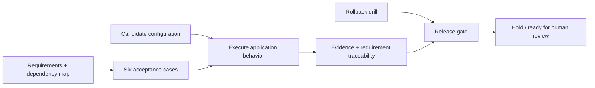

# ReleaseLens
### See the risk before release.

An executable systems analyst case study for a **research service-request application upgrade**. It connects requirements, dependency impact, regression evidence, defects, rollback verification and release recommendations in one reviewable package.

**Independent portfolio simulation using synthetic data.** No hospital system was accessed or changed. No real user acceptance, vendor approval or production release is claimed.

## The decision

A fictional upgrade appears to work for managers, but introduces three regressions: analysts can approve requests, the approval status changes incompatibly, and the audit trail disappears. Should the release proceed? ReleaseLens executes the same acceptance catalog against the baseline, faulty candidate and corrected configuration, then produces a reasoned gate decision.

| Executed configuration | Acceptance cases passed | Recommendation |
|---|---:|---|
| Baseline | 6/6 | Ready for review |
| Faulty candidate | 3/6 | Hold |
| Corrected configuration | 6/6 | Ready for review |

The corrected configuration deliberately returns to the known-good rules; this is a regression-remediation exercise, not a new feature claim. **Ready for review does not authorize deployment.** See [results](results/RESULTS.md) and [machine-readable evidence](results/report.json).



## Run the assessment

Python 3.10+; standard library only. No installation, account or credentials required.

```bash
python3 releaselens.py
python3 -m unittest discover -s tests -v
```

Reports are written to `results/`; `--output /path/to/new-folder` selects another folder. **14 automated tests** validate the assessment framework, in addition to the six acceptance cases executed against each of three configurations. They cover stale evidence, incomplete/duplicated results, missing requirement coverage, traceability tampering, invalid budgets, rollback failure and transitive dependency impact.

## Reviewer path

1. Read the [requirements, dependency analysis and UAT plan](docs/ANALYSIS.md).
2. Inspect the [defect register and change decision](docs/CHANGE_RECORD.md).
3. Compare the [executable test catalog](data/release.json) with the generated evidence.
4. Review the [training and support handover](docs/HANDOVER.md).
5. Check [role alignment and limitations](docs/CONTEXT.md).

## Design boundaries

The gate checks configuration/test-catalog fingerprints so old evidence cannot be accidentally reused for changed inputs. It requires every case exactly once, coverage of all listed requirements, passing tests, consistent traceability and a successful rollback drill. Hashes are provenance checks, not signatures: externally supplied evidence is not trusted or authenticated. The normal demo generates evidence directly from the application harness.

The application is an in-memory administrative workflow. Roles are test inputs, not an authentication system. Rollback covers configuration restoration and preservation of existing in-memory records/audit, not schema migrations, infrastructure failure or writes made during an unsafe deployment. There is no electronic sign-off system or deployment automation. A real release needs representative integrations, accessibility/performance/security testing, vendor review and actual business approval.

## Resume-ready wording

- Developed a Python release-assessment lab linking four requirements to six executable acceptance cases, dependency impact analysis and configuration-specific test evidence.
- Detected three simulated upgrade regressions and verified the corrected configuration, supported by 14 automated framework tests, rollback checks, a defect register and a user-training handover.
