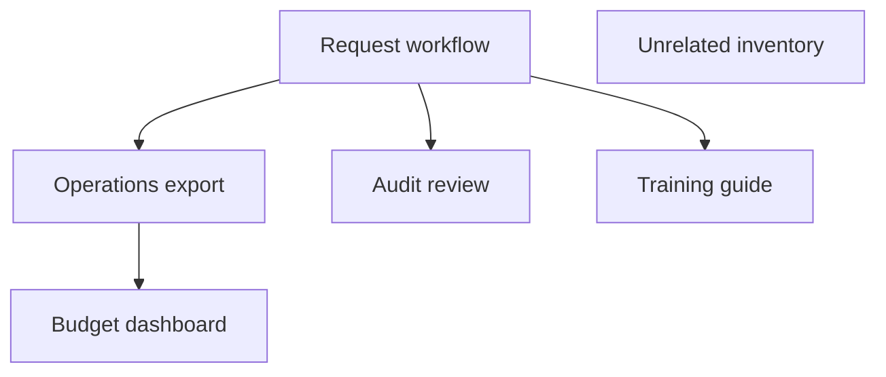

# Requirements, impact analysis and UAT

## Business context

Fictional research teams submit administrative service requests. A manager approves a request with a positive budget. Operations consumes the status through an export; a dashboard summarizes exported requests; auditors inspect approval history. This does not model study eligibility, IRB approval, consent or clinical decisions.

Assumed stakeholders: research coordinator (workflow owner), application analyst (configuration and test coordinator), manager (approval-rule SME), integration owner (status contract), audit reviewer (history requirements), change approver (release authorization). No stakeholder interviews or approvals were conducted for this portfolio exercise.

**Current workflow:** manager approval writes an `approved` status and an audit record. **Proposed upgrade:** evaluate candidate configuration without breaking that approved contract. The visible positive-path workflow alone is insufficient evidence: unauthorized access and missing audit entries must also be tested.

## Traceability matrix

| Requirement | Acceptance cases | Business risk if broken | Assumed reviewer |
|---|---|---|---|
| R01 Only manager may approve; denial writes nothing | U01 manager allowed; U02 analyst denied | Unauthorized administrative commitment | Workflow owner |
| R02 Positive numeric budget required | U03 missing budget; U04 negative budget | Invalid request enters planning | Manager |
| R03 Stable approved status contract | U05 exact `approved` status | Export/dashboard no longer recognizes approvals | Integration owner |
| R04 Successful approval creates an audit record | U06 audit count equals one | Decision cannot be traced | Audit reviewer |

The test catalog in `data/release.json` is the executable specification. Cases run in isolation. The 14 framework tests separately verify gate logic and defensive behavior. Passing the catalog demonstrates only the requirements represented here, not comprehensive enterprise acceptance.

## Impact analysis

The dependency algorithm includes transitive consumers, not just directly connected modules. Changing request-workflow identifies five affected components including itself; unrelated-inventory is excluded. This is a declared configuration dependency map, not automatic discovery of a live estate. Ask each owner to validate the map before a real impact assessment.

## Proposed UAT session

1. Analyst shares release scope, four requirements, test catalog and acceptance criteria.
2. Coordinator and manager perform U01–U04 in a representative nonproduction environment.
3. Integration owner validates U05 through the actual export and dashboard, beyond this local contract check.
4. Audit reviewer validates U06, including actor identity and timestamps in the actual application.
5. Record observed results, environment/build version, evidence reference, tester, date and defect ID. Do not prefill signatures.
6. Retest resolved defects and run regression plus rollback checks. Obtain actual business and technical approvals.

Release criteria: complete traceability, no failed critical cases, evidence matching the assessed build/configuration, documented rollback and approved support/training handover. The demo's technical recommendation is not a substitute for this human review.
